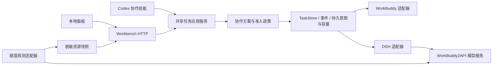

# 多 Agent 协作、模型选择与额度观测设计

修订日期：2026-10-25。状态：完整目标设计，T3a 契约准入及 T3c 额度观测基础已实现，其余目标尚待交付。当前可用能力以 [PROGRESS.md](PROGRESS.md) 与 [stage-2 HTTP](WORKBENCH_STAGE_HTTP.md) 为准；本文不修改已安装技能、DSH 配置或运行网关。

实现进度：契约派工基础见[T3a 说明](T3A_DISPATCH_ADMISSION.md)，后台额度缓存与只读资源见[T3c 说明](T3C_QUOTA_OBSERVATION.md)。下文描述完整目标；DSH、真实额度联调、自动策略与面板模式尚未交付，不把存储/准入或合成验证推导为完整协作能力。

## 1. 产品目标与对象

项目演进为 Codex 主导的本地开发协作工作台。Codex 判断任务是否适合协作、明确约定、选择执行器并独立验收；WorkBuddy、DeepSeek Harness（DSH）负责适合委派的执行。用户可以覆盖推荐，也可以预先授权自动调度。首期仍只面向 Windows、本地单用户。

| 对象 | 职责与区别 |
|---|---|
| 协调者 | 当前 Codex 对话，负责计划、监督与独立验收；直接处理也是合法决策 |
| 执行器 | WorkBuddy desktop-queue 或 DSH 原生会话；提供工具、目录访问与执行生命周期 |
| 模型来源 | 为执行器提供模型的连接，例如 WorkBuddy2API；与执行器名称分开 |
| 模型 | 来源内的精确模型 ID；同名模型不代表相同来源、账号池或已核验的实际模型 |
| 额度范围 | 网关实例、区域、API Key 路由、账号池与模型形成的可见权益范围 |
| 任务与轮次 | task 保存不可变目标与政策；attempt 保存一次执行、模型绑定与证据 |

本轮目标接入链路为 `DSH → WorkBuddy2API → 上游模型账号池`。WorkBuddy2API 是模型服务与额度观测来源，不负责判断开发任务成功。DSH 本身没有独立于模型来源的通用余额。

## 2. 已有基础与接入缺口

- T1/T2 已提供共享只读查询、SQLite 持久事件和 revision，可以复用；它们不证明 DSH 已接入统一任务链路。
- `dsh-codex-workflow` 已有指定会话桥接、执行交付和 Codex 审查流程。现有派工协议没有执行模型选择字段；其 Planner/Reviewer 模型设置控制的是 Codex 角色，不等于 DSH worker 模型。
- 本地 DSH 依赖存在模型目录、会话模型选择与请求头记录能力。适配器必须按目标宿主版本验证，不能仅凭类型存在宣布真实执行通过。
- WorkBuddy2API 已有用量统计、API Key 归因、模型额度估算、冷却与重置记录。已有 Key 统计不等于单个 task 的精确消耗；单任务关联仍需实现。
- 历史 DSH 自动审查失败保留原身份与原因。修复并独立复验前，`automaticReview` 能力为不可用；可在执行与停止已确认后，由原 Codex 独立审查，并明确记录审查通道。

## 3. 用户模式与方案记录

| 模式 | 派工行为 |
|---|---|
| `manual` | 用户指定执行器、来源与模型；缺少必要信息或不符合政策时说明原因，不擅自替换 |
| `recommend` | Codex 给出方案、理由与额度信息，用户确认或修改后才派工；未回复不算同意 |
| `automatic` | 在用户已保存的执行器、模型、费用、项目与任务范围内自动决定；越界时等待新的授权 |

未设置自动政策时默认 `recommend`；用户已明确指定并授权的派工不重复确认。模式只决定协作方案，不扩大修改范围、提交、推送、部署或原生权限的授权。

派工前形成可保存的 `CollaborationPlan`：`planId`、版本、工作区、目标摘要、`decision`（`direct`/`delegate`）、模式、推荐执行器与精确模型、选择来源（用户/策略）、理由、被排除候选与原因、政策版本、额度快照引用和确认状态。修改方案产生新版本；实际任务引用被确认的版本，不能悄悄替换。

`direct` 表示协调者按既有授权自行处理，不创建虚假原生轮次或执行器占用。方案预览只使用已提供的上下文及本地元数据；不为选择执行器扫描整个项目，也不启动 worker 或额外计费模型请求。

## 4. 自动协作策略

按下列顺序决策，先采用可解释规则，不另建模型路由服务：

1. 遵守用户指定、自行执行要求、项目范围和已授权费用政策。
2. 判断交接收益：一次局部小改优先直接处理；需要持续实现、自测的完整阶段适合委派。核心方案仍由协调者负责。
3. 核验执行器在线状态、目标目录、会话身份、模型选择、停止观察及报告能力。能力缺失的候选不可推荐为可执行。
4. 按任务的工具、上下文、图像输入、检查要求筛选来源和模型；不把模型名当作能力证据。
5. 结合有来源的额度、恢复时间、期限和已有任务占用做选择。未知或过期额度不按充足处理；是否准入取决于政策要求，不一律等同额度为零。
6. 有足够样本时参考同类任务的独立验收率、返工、耗时及人工介入。样本数、时间范围与局限可见；检查器错误单列，不凭单次失败永久降低执行器优先级。

每次派工在持久意图内保存最终决策；派工前重新核验候选和政策。暂不可用时优先说明阻塞或等待，不静默升级模型、启用其他来源或另造任务绕过预算。

## 5. 模型选择与政策

界面可选择执行器、模型来源、精确模型与已支持的推理档位，并显示能力、费率核验与额度新鲜度。目录可见只表示被宣告，不证明账号可用、免费或请求会成功。

`requestedModel`、执行前读回的 `selectedModel`、实际请求证据中的 `effectiveModel` 分开保存，均包含来源身份。证据分级标记为 `declared`、`selected`、`request_observed` 或 `unavailable`；通过代理看到请求模型只证明该层的路由，不证明代理背后的物理模型。无法达到任务政策要求的核验级别时拒绝派工或标记阻塞，不填写假确认。

模型政策从固定单一批准项演进为版本化白名单：允许执行器/来源/模型、推理档位、免费要求、计量要求和可执行费用限制。默认保留现有精确免费模型约束。付费模型默认不授权；只有用户显式设定费用政策且来源提供足够计量/控制能力后才可使用。

额度估算不能提供硬费用封顶。要求硬上限而来源无法控制时拒绝该付费方案，不能用刷新余额代替费用保证。开始后的请求可能已产生费用，取消也不等于撤销消耗。

首期 task 的执行器、来源和模型固定，运行中的 attempt 不支持切换。用户手动改动 DSH 会话模型后，适配器须检测绑定漂移并阻止后续受控操作；未知执行保持原占用。未来跨模型或跨执行器交接需专门设计，保留停止证据、文件基线和累计预算，不作为自动重试。

当前父级 Codex 对话的模型由宿主控制，不能由选择 DSH worker 模型的菜单修改。自动 Planner/Reviewer 是独立角色和计量来源；缺少可控接口时只展示真实状态，不承诺动态切换。

## 6. 共享服务与适配器

技能层提供统一协作入口，负责判断、计划、监督与验收；WorkBuddy 与 DSH 的派工示例、工具发现和恢复规则按执行器分开维护，按需读取。入口不得把未安装的 DSH 技能/插件当成已连接能力；安装或修改配置另走明确流程。现有 WorkBuddy 技能继续可用，本次仅修改设计，不改名称、自动触发范围或运行模型限制。

执行适配器统一提供能力描述、发现、只读观察、模型准备与核验、派工、取消、停止证明、报告收集和同任务返工。未支持的动作明确返回不可用。模型准备会修改目标会话，仅在已授权派工准入阶段执行；目录/health 查询不修改模型。最终 accept 由共享验收服务决定，执行器的完成或插件审查不直接写为最终成功。

能力至少区分 `modelCatalog`、`selectModel`、`observeEffectiveModel`、`cancel`、`proveStopped`、`navigateSession`、`automaticReview`、`usageAttribution`。在线、可派工、可停止、可验收分别观察，不能由一个 ready 布尔值推断全部正常。

DSH 以用户选定的目标会话和规范化工作区匹配，不默认选最新会话。零个或多个候选时返回候选与原因；只有明确授权自动新建会话时才允许创建。已有任务只恢复原绑定，不能通过新会话绕过不确定投递。

原 DSH 插件可保留自身存储与私有审查线程；适配器持久关联外部 workflow/session 身份。统一任务状态与最终验收由 TaskStore 管理，不复制出第二套成功状态机，也不把 `platform/` 的 HubRun 当作新任务真源。

## 7. 额度、用量与单任务归因

WorkBuddy2API 通过后端只读适配器接入；浏览器只访问本项目的脱敏接口。连接凭据保存在本机受保护配置，不返回前端、事件、公开日志或导出。共享容量控制代码执行，模型账号池可以被其他客户端同时使用，二者分开。

`QuotaSnapshot` 必须保存：本地快照 ID、来源连接 ID、匿名额度范围、模型 ID、计量单位、采集/来源观察/过期时间、可用状态、已用/预算/剩余量、重置时间、估算方法与局限。数值不可得为 null；`0` 只表示已知零。

必须分别标记 `valueKind`（`reported`/`estimated`/`unavailable`）、`availability`（`available`/`exhausted`/`unknown`）与新鲜度（`fresh`/`stale`/`unavailable`）。额度估算与“已触顶且冷却”可以同时出现；不能因某个窗口标记 `estimated=false` 就宣称全部预算由上游精确报告。

WorkBuddy2API 当前剩余量主要以历史触顶样本估计预算，再减去观测用量。冷却与恢复时间有独立证据。面板须继承这些局限，不能把估算百分比包装为官方余额。积分、token、货币估算分别展示，不跨单位相加；模型账单与任务期限/轮次预算也分开。

额度筛选遵守实际 Key 绑定的区域、模型限制、可用账号池和护栏。无法可靠解析路由时仅显示“网关汇总，未验证为该任务可用”；不把所有账号余额当成 DSH 独占额度。同一池被多个来源引用时按共享范围去重，不重复汇总。

单任务计量用不可伪造的本地任务关联记录绑定 `taskId/attemptId → DSH 请求 → 网关请求/重试 → 用量记录`，不把本地路径和目标正文传入计费标签。不假定网关已有透传协议；需要实现双方认可的关联机制并验证原始日志。缺少请求关联时只显示连接级用量，task 用量为 null；余额前后差不能冒充精确任务成本。重试、worker 与 Planner/Reviewer 费用分开去重统计。

后台采集使用受控轮询、超时、退避、缓存和最大陈旧时间。面板 GET 只读已保存快照，不同步任务、不调用模型、不触发额度探测。WorkBuddy2API 自身的缓存/归档可能有内部写入，不能因此声称整个外部服务零写入。会发送最小模型请求的主动探测默认不启用，需单独授权、计量和审计。

额度源故障时保留最后快照并标陈旧，不显示为零或充足；任务详情查询仍独立可用。正在执行的任务继续按既有期限监督，不因观测连接失败自动换来源、重新派工或失去停止能力。估算不足可以提醒，不能据此自动终止执行。

## 8. 面板与交互

- 派工预览：直接处理/委派、选择模式、执行器、模型来源、模型与推理档位、推荐理由、政策和额度观察时间。
- 任务详情：请求/选择/观测到的模型、核验层级、原生会话定位、执行与独立审查来源、固定期限和剩余轮次。
- 资源页：按来源和模型展示共享额度、估算标识、冷却/恢复、受限原因、未知/陈旧状态和连接级用量。
- 活动任务模型选择锁定；重新配置影响未来任务，不重写历史约定。接管只允许已验证的原生操作，不代批权限。
- 等待输入、即将到期、停止不明和额度阻塞可显示待处理项；桌面通知与通知频率由用户设置，首期不发送外部消息。

既有只读原型 F01–F20 不变；新增协作/额度场景另列，不要求旧原型立即实现写操作。新增真实接口上线后单独做联调，不把 mock 的模型列表或额度当成真实发现。

## 9. 需要一起完善的能力与优先级

| 优先级 | 补充能力 | 验收重点 |
|---|---|---|
| P0 | 执行器能力与宿主兼容诊断 | 模型目录可读但执行/停止不可用时，不显示为可派工 |
| P0 | 方案审计与权限边界 | 用户覆盖优先；自动选择可解释；预览无模型/派工副作用 |
| P0 | 精简交接包与固定验收 | 交接包含基线、目标、范围、必要上下文、正向通过条件和已知失败；缺陷复现与修复通过脚本明确区分，不以反转断言替代满足原约定 |
| P0 | 会话/模型归属与防重复 | 精确绑定；手动漂移、重启和投递不明不创建替代执行 |
| P0 | 两执行器共享项目保护 | 首期共享数据目录总容量 1；同目录不因切换执行器获得第二份容量 |
| P0 | 额度可信度与故障隔离 | 来源/单位/范围/陈旧可见；资源故障不污染任务状态与停止观察 |
| P0 | 独立验收与检查器归因 | worker 报告、插件审查、协调者决定分开；检查器错误不制造 worker 返工 |
| P1 | 单任务请求归因与审查成本 | 完整关联才计量；共享池外部消耗、重试、审查不重复或错误归属 |
| P1 | 项目级预设与重启恢复 | 模板复制目标/检查/策略，不复用身份、过期证据或偷偷增加旧预算 |
| P1 | 人工待处理与故障诊断导出 | 保留最后可靠观察、恢复说明和脱敏证据，通知去重 |
| P1 | 同类任务质量统计 | 只有真实独立验收样本才参与，报告样本量与未知费用 |
| 后续 | 跨执行器交接与安全并行 | 先定义停止、累积预算、独立 worktree 与合并冲突，再另立验收；首期不承诺 |

不纳入首期：云端团队共享、多租户、账号托管/自动轮换、额度套利、绕过上游限制、自动付费升级，以及自动接管正在运行的其他会话。集成仅取所需能力；引用或分发第三方代码时保留来源和适用声明。

## 10. 实施顺序与完成门槛

| 阶段 | 交付 | 阶段验收 |
|---|---|---|
| T3a | 新版契约、协作方案和模型政策；工作区与真实派工约定绑定 | vnext-1 原样兼容；新字段不能被旧代码忽略；方案确认与最终参数一致 |
| T3b | DSH 适配、目录与会话发现、执行模型选择/观察、真实执行闭环 | 同一原会话派工/停止/返工；模型证据准确；原自动审查故障不冒充已修 |
| T3c | WorkBuddy2API 额度后台采集与只读资源快照 | 脱敏、共享范围、估算、未知、过期与故障隔离；不主动探测 |
| T4 | 多入口意图/回执、全局容量及模型准备幂等 | 崩溃不重复派工；两执行器共同遵守容量 1；不确定准备/投递被保留 |
| T5/T6 | 文件保护、独立检查、不可变 reviewId 与最终验收 | 旧改动保留；证据绑定源码/轮次/执行器；停止不明不得通过 |
| T7 | 三种用户模式、真实面板、自动策略、单任务计量与发布验证 | 在 T3–T6 对应约束验收后开放写操作；真实桌面与异机证据分类 |

T3 各子阶段只集成一个可独立验收的结果，不一次交付整个调度平台。内部受控派工验证不能当成新的 HTTP 写入口已获准上线。具体场景见 [ACCEPTANCE.md](ACCEPTANCE.md) C01–C18；设计接口见 [INTERFACE_CONTRACT.md](INTERFACE_CONTRACT.md) 第 8 节。本设计不承诺节省费用或提高成功率，效果需后续固定任务对照验证。
