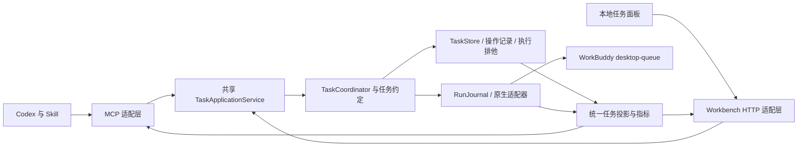

# WorkBuddy Executor 下一阶段总体设计

设计修订：2026-10-19。原始代码基线：`332d2dd`；Windows 部署改造：PR #1，已合并至 `main`。状态：待实现的 vNext 设计；代码合并不代表本机已部署或跨机器、跨平台验证。

本文记录可供社区讨论和实现的技术设计。[接口契约](INTERFACE_CONTRACT.md)规定数据与操作语义，[公开路线图](../ROADMAP.md)列出阶段目标，[验收场景](ACCEPTANCE.md)规定行为标准。本文不包含个人分工或内部排期。

## 1. 开发方向与版本范围

项目定位为本地 AI 开发协作工具：Codex 定义任务与独立验收，WorkBuddy 完成适合委派的执行工作，程序维护任务身份、边界、执行证据和停止状态。用户能够理解进度、处理必要的原生输入并检查最终交付。

下一阶段的优先顺序是：可靠执行、可验证交付、清晰接管、可复现安装。任务路由采用可解释规则：范围明确的简单小改默认直接处理，用户明确要求委派时遵从；不为路由而扫描整个项目或另调大模型。

vNext 的平台目标调整为 Windows 与 macOS，保持本地单用户、Codex MCP、WorkBuddy desktop-queue，以及连接同一执行内核的本地任务面板。继续使用现有 TypeScript、Node、SQLite 和原生桌面适配器；已验证支持的 Node 版本由 `gateway/package.json` 与安装诊断保持一致。平台目标与当前支持范围分开：每个平台完成真实安装和任务验收后，才对该版本声明支持。

| 平台 | 当前事实 | 下一步与支持门槛 |
|---|---|---|
| Windows | PR #1 已合并，提供路径探测、安装维护、只读诊断与隔离验证；Windows CI 已运行；第二台物理机器真实验收待完成 | 保留 Windows 回归，并按验收清单完成同平台异机验证 |
| macOS | 保留上游原生连接和 launchd 服务代码；社区版真实兼容性未验证；当前 setup 拒绝非 Windows，doctor 报平台未验证 | 先记录构建、适用测试及原生链路阻塞，再实现 Mac 安装/诊断并取得真实闭环证据 |

先调查 macOS 平台基线，并推进共享服务与面板。macOS 调查可与契约 mock 并行；其安装或真实派工被阻塞时，先登记缺陷，不能按 Windows 安装指南强行执行或把继承代码标为支持。

多执行器平台、Linux、云端团队协作、跨机器共享任务数据库、多任务并行调度、自动批准原生权限和动态付费模型切换列入后续候选，不是本版完成条件。跨平台开发仍使用各机器独立的配置、账号与运行数据。

## 2. 事实基线与问题依据

现有实现包含：

- `gateway/src/coordinator.ts`：初始请求指纹、同任务返工、认证报告验收、引用验证记录复核。
- `task-store.ts`、`run-journal.ts`、`desktop-queue.ts`、`persistent-service.ts`：任务与轮次记录、原生执行和停止证据。
- `native-desktop-trigger.ts`、`native-ownership.ts`：原生身份与归属检查。
- `server.ts` 与 `scripts/workbuddy-call.mjs`：MCP 与官方调用入口。
- 仓库根目录 `SKILL.md` 和 `references/`：当前维护的技能；网关内副本需随发布同步。
- `gateway/src/platform/`：已有上游工作台与独立 HubRun 生命周期；不是当前技能的默认执行入口。

现有并不等于下一阶段已完成：共享入口的并发排他、结构化输入提示、统一投影、范围验收、统一指标及新机安装仍需按任务清单实现和验证。不能用现有函数名或文档替代行为验证。

[历史对照](../benchmarks/2026-10-18-luna-workbuddy/REPORT.zh-CN.md)的六组样本中，直接执行最终通过 6/6，监督 WorkBuddy 通过 4/6；两组时钟完整的观察为 76/457 秒、68.643/430.4 秒。重复出现的额外记忆文件、原生权限等待、取消后无法继续、验收器格式误拒及手工账目漂移，构成本版问题清单。历史样本小、指标不全，不推导总体速度或成本优势；原始结果保持不变。

## 3. 必须保持的执行约束

1. 免费模型政策由程序执行。当前批准项为 `deepseek-v4.1-flash`，派工和返工前确认精确 ID 与 `x0.00`；不可用、费率未知或不匹配时停止该操作，不静默换模型。
2. 同一初始任务的 taskId 与初始约定不可变。投递结果不明时恢复观察原身份，不换任务键重派。
3. taskId、attemptId、sessionId、runtimeSource 和当前报告必须相互匹配。
4. 远端停止必须有原生证据。回合结束、报告落盘、UI 显示取消和停止请求成功均不单独证明停止。
5. 未确认停止时禁止重叠返工、新派工和验收。一个共享网关数据目录最多持有一个未关闭工作流。
6. 默认首次执行加两轮返工。UI 不提供绕过限制的重置按钮；修改已存在任务的预算或初始约定不属于恢复。
7. 每个 attempt 的绝对 deadline 在启动后固定。重连、客户端关闭和人工等待不延长它；新返工轮次按原政策建立自己的期限。
8. 原生权限在 WorkBuddy 原生界面处理。当前 desktop-queue 不提供网页代批；未来能力须独立验证后再声明。
9. 已取消任务保持终态。人工输入恢复、正式取消、到期停止是不同操作；不得把取消包装成暂停。
10. worker 自报完成只进入待审流程。最终验收需要独立检查、真实报告、停止证明和与当前文件匹配的证据。

## 4. 目标架构

`TaskStore` 与 `RunJournal` 仍保存原有业务事实和执行事实。新增统一投影供两个入口使用，不另外建立一套能够自行决定任务成功的 UI 数据库。

新增的 `TaskApplicationService` 包装并复用 `TaskCoordinator`，集中处理排他、操作幂等、约定、验收与事件。MCP 和 HTTP 都调用它；不能只在面板按钮上实施限制。原生持久服务继续负责实际监督，浏览器轮询不建立第二条唤醒/派工链路。

旧 `platform/` 可复用界面和本地 HTTP 防护思路。本版不直接拿 HubRun 的 completed/review 状态替代 TaskStore 与原生状态，也不让两个引擎同时管理同一原生任务。

平台差异集中在配置探测、进程身份/停止证明、原生连接、后台服务及安装入口；免费政策、去重、轮次、验收和指标继续共用同一套程序规则。先梳理现有分支，再提取必要的适配边界；不另建两套 coordinator 或 UI 状态机。macOS 需要核查应用位置、原生数据路径、launchd 与权限等待；Windows 保留进程归属和服务生命周期检查。任一平台无法取得停止证据时，都保持停止不明及排他。

模块按共享应用服务、契约、执行适配和视图区分；认领与协作方式见贡献指南。设计中的新模块、端点和命令均未实现。

## 5. 任务约定与文件范围

派工前保存版本化 TaskContract：目标、项目、可改文件、必需检查、必要语义验收、模型与轮次限制。自然语言需求仍保留，但不能仅依赖提示词实施机器可检查的约束。

范围检查比较派工前基线与交回时实际文件增量，覆盖新增、修改、删除、重命名及二进制文件。保留用户原有未提交修改；不能将其误算为本轮增量或自动还原。无法可靠区分并发用户改动时标记冲突，要求独立核对。

路径统一为工作区相对路径，并进行真实路径归属检查。Windows 大小写/junction、macOS 实际卷的大小写行为与路径别名、中文/空格路径、`..`、绝对路径、symlink、删除目标、移动目标和检查后的路径变化均须有适用测试；不假定所有 Mac 文件系统都忽略大小写。程序自己执行的文件操作越界或无法确认时拒绝操作，交付增量越界时拒绝验收。

本版的范围兜底是已登记工作区内的可观测增量检查和本程序处理路径的限制，不是操作系统文件系统沙箱。WorkBuddy 自身工具未必都经过网关，不能宣称阻止了所有外部写入。能取得结构化原生工具路径证据时，将已知外部写入记为违规；未取得全面证据时明确检查覆盖范围。真实试用优先使用独立项目副本或 worktree；硬文件系统隔离另作后续设计。

应用运行元数据和交付物分别记录，但都要有明确规则。默认不允许任意隐藏目录写入；不得通过忽略整个 `.workbuddy-ai/` 来掩盖额外修改。允许的元数据路径须在派工前明确，独立展示和验证，不能在失败后临时补白名单。

额外记忆文件先做来源与触发条件调查：优先验证任务级约束能否避免写入；如确需许可元数据，提交明确、最小的路径政策。对无法控制的原生行为如实显示限制，不修改账号、安全设置或原生数据库绕过。

基线扫描应跳过版本控制和依赖缓存等明确的扫描排除项，但“无需扫描”不等于“允许修改”。授权修改范围内若包含被排除目录，必须单独建立可验证基线；无法建立则阻止该约定执行。

## 6. 生命周期与人工接管

业务状态与原生执行状态分开保存，面板显示由服务端统一推导。具体优先级见接口契约；两个客户端不得自行用字符串猜测是否可验收。

人工接管至少展示：项目与会话标题、所需操作、可获得的脱敏命令/文件摘要、剩余期限、最后观测时间、原生界面处理说明。取不到具体权限内容时明确“详情不可用”，用户到原生会话核查；不能把笼统 waiting_input 伪装成已知权限类型。

原生会话导航是能力开关。只有验证支持后才出现“打开会话”；否则提供标题、项目位置和定位步骤。普通页面不要求用户识别 UUID，技术身份放在详情中。

取消操作明示“结束此任务，不能恢复”。正式取消与输入恢复不混用；需要刷新状态时只观察原任务。新任务与恢复按钮都服从服务端允许动作和排他锁。

超时的处理顺序：固定截止事实、请求正式停止、核对原生归属与停止、保留产物和迟到报告、记录终态。迟到报告不能变成按期交付；未证实停止时保留排他，不因锁时间到而自行释放。

## 7. 独立验收

验收分四类：执行来源与身份、文件范围、必需机器检查、必需语义检查。机器检查结果、人工判断、worker 自报三者分别保存。

检查结果包含 `passed/failed/unknown/not_applicable/checker_error`。必需检查中的 unknown 和 checker_error 不能当通过。验收器错误需要修正验收记录并留审计；若原任务没有格式约束，不能凭标题、项目符号或措辞差异要求 worker 返工。

对语义检查可依据原约定记录人工复核。身份、原生停止、越界、验证记录哈希等程序不变量不能靠人工注释覆盖。任何“验收器误拒更正”须保留原失败记录、原约定、复核理由和证据。

验收发生时复核当前 attempt、报告摘要、原生停止及相关输入/源码哈希。检查后文件变化、客户端旧页面和旧轮次报告不能通过验收。历史验收决定保留其当时快照，不等于对未来文件状态持续背书。

## 8. 自动统计与可观测性

时间、调用和事件由程序采集，用户不再手写结果 JSON。所有协议时间使用 UTC ISO 8601，UI 转成本地时间；计时计算用原时间戳，不依赖 PowerShell 隐式日期转换。

记录任务接收、轮次排队/领取/报告、输入请求、原生停止、验收和关闭；观察时间与事件发生时间分开。超时后很久才重连，不把这段间隔算成模型工作时长。

主要输出包括：

- 任务端到端 wall elapsed、排队时间、输入等待、报告到停止及停止到验收的间隔；无法分解的区间为 null。
- 按调用通道区分 MCP、CLI、原生请求和本地检查；记录成功、非零失败、结果不明，不将本地启动失败混作网关调用。
- 按捕获类型区分 stdout、stderr、合并输出和实际传输字节。不能从 CLI 文件大小估算 token。
- 首轮与最终验收、外部返工、worker 自纠、恢复事件和人工介入分别计数；恢复和返工不重复分类。
- 返工原因区分 worker_content、worker_scope、reviewer_error 与 unknown。
- 模型目录费率标签、实际消耗、token、活跃推理时间分别保存。未暴露的成本保持 null，不用零补齐。

新统计口径单独版本化。历史 `benchmarks/2026-10-18-luna-workbuddy/` 的数据、验收器和缺陷记录保持原样；新对照放在新目录，事先固定任务与验收条件。

## 9. 面板、安装与使用体验

面板首版有三个主要视图：任务列表、任务详情/验收证据、环境与待处理操作。提交时选择已注册项目，填写目标与预期交付；模型及其核验状态可见，技术身份和完整事件折叠。

前端先根据契约 mock 开发，再接真实服务。按钮使用服务端 allowedActions；操作仍由服务端重新核验。网络断开显示最后观测时间并重连原任务，不自动创建替代任务。浏览器每两秒可以读取本地快照，不能因此每两秒调用模型或原生桌面接口。

本地 HTTP 仅监听 loopback，校验 Host/Origin，拒绝跨域访问与未认证修改；借鉴已有 `platform/http.ts` 的本地认证措施。默认不返回原生历史、密钥、账号或可任意读取的绝对文件路径接口。验收证据导出与应用运行数据分离，导出时脱敏。

目标安装诊断按 Windows/macOS 分开检查 Node 版本、WorkBuddy 路径、可观测的连接状态、免费模型政策、构建/运行哈希、项目登记及目录可写性。无法证明的登录和额度状态保持 unknown。诊断默认不派工、不改变系统策略、不重启正在执行的应用。

已合并的 Windows 部署改造统一了 Node 下限、加入配置探测与只读 doctor，提供安装/升级/卸载及独立验收入口；第二台物理机器的真实验收仍待取得。当前 [Windows 安装说明](../gateway/docs/INSTALL_WINDOWS.md)仅适用于 Windows。macOS 安装和诊断先作为单独任务实现，验证前不提供声称可用的 Mac 安装命令，也不删除现有平台限制来制造通过。

两平台共用安装预览、既有配置保护、活动任务拦截、重复安装、备份、升级和卸载语义；应用探测与后台服务按平台实现。发布文件记录系统、CPU 架构、Node 和 WorkBuddy 版本；在一个架构上通过不推导其他架构也通过。

## 10. 社区协作与发布边界

贡献者通过 Issue 讨论、独立分支与 PR 协作。任务认领和审查规则见 [贡献指南](../CONTRIBUTING.md)，个人投入时间和内部排期不作为公开技术文档的一部分。

仓库是开发真源。本机安装的 skill、网关运行目录、MCP 进程和仓库不是同一个对象。源码合并后仍需构建、核对哈希、备份、部署及验证，推送不等于上线。

开发者各用独立配置、数据目录、原生会话与项目副本。任务数据库、凭据、应用会话、node_modules 和运行日志不经 Git 共享。共用网关时所有入口遵守同一排他，不得同时控制同一原生会话。

`gateway/dist/`、发布包和 `SNAPSHOT_MANIFEST.json` 在集成阶段由发布维护者统一生成，不手工修改编译产物或哈希绕过检查。涉及根技能与网关副本时应保持内容一致。发布前检查文件、历史、附件和元数据的公开范围；提交作者可使用 GitHub 隐私邮箱。

平台适配分别提交可审查的 PR，公共文件由认领者协调；未在本机运行的平台用例明确标为未执行，交给对应环境复测。Windows GitHub Actions CI 已覆盖构建、相关测试及技能/产物一致性；macOS CI 待建立。模拟平台参数或 CI runner 不替代真实桌面测试；工作流通过也不等于仓库已配置必需状态检查。

## 11. 完成条件

- 所有 [P0 场景](ACCEPTANCE.md)验证通过；自动测试、模拟测试、真实桌面测试分别报告。
- 正常任务和同任务返工可闭环；输入等待、超时、停止不明和取消没有重复派工或虚假成功。
- MCP 与面板对同一任务返回一致身份、状态和允许动作；并发请求不能突破单任务排他。
- 机器约束和语义复核分开，所有必需证据与当前交付一致。
- 自动导出的统计可复算，null、零、失败、结果不明可区分。
- 对每个声明支持的平台，至少一台真实机器完成按文档安装、正常任务、同任务返工、取消、重连、升级与卸载；Windows 与 macOS 分别记录系统/架构和证据，不相互替代。
- 同一平台的第二台物理机器复现作为独立项目记录。Windows 异机验收仍待完成；一台 Windows 加一台 Mac 不能把它标为通过。发布说明明确本机、隔离、CI、真实原生与同平台异机验证的覆盖范围。
- 生成包、源码和运行版本可对应，文档记录已知限制、回退方式及第三方来源/许可核对结果。

完成条件是发布门槛，不承诺性能提升或费用节省。阶段目标见 [公开路线图](../ROADMAP.md)，参与方式见 [贡献指南](../CONTRIBUTING.md)。
