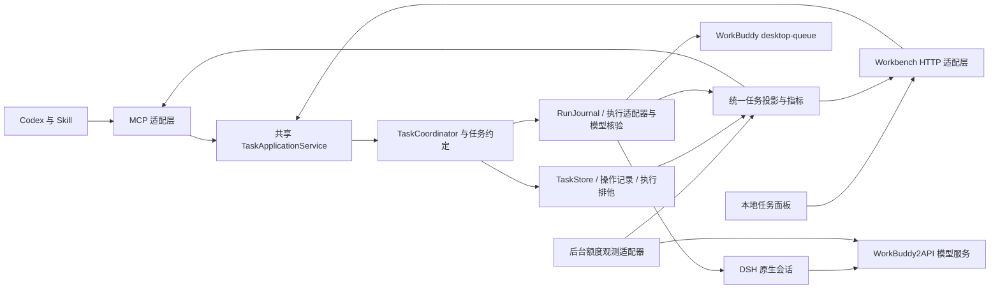

# WorkBuddy Executor 下一阶段总体设计

设计修订：2026-10-25。状态：T1/T2 基础已实现，新增多 Agent 协作、模型选择与额度观测为待实现目标。实现基线为 `a9ca141`；阶段现状与证据见[开发进度](PROGRESS.md)，新增方案详见[协作设计](COLLABORATION_DESIGN.md)。代码提交或合并不自动代表部署或跨机器验证。

本文记录可供社区讨论和实现的技术设计。[接口契约](INTERFACE_CONTRACT.md)规定数据与操作语义，[公开路线图](../ROADMAP.md)列出阶段目标，[验收场景](ACCEPTANCE.md)规定行为标准。本文不包含个人分工或内部排期。

## 1. 开发方向与版本范围

项目定位为 Codex 主导的本地开发协作工作台：Codex 定义任务、制定协作方案并独立验收，WorkBuddy 与 DSH 完成适合委派的执行工作，程序维护任务身份、边界、模型绑定、执行证据和停止状态。用户可以手动指定执行器/模型、确认推荐或在已授权政策内使用自动调度。

下一阶段的优先顺序是：可靠执行、可验证交付、清晰接管、可复现安装。任务路由采用可解释规则：范围明确的简单小改默认直接处理，用户明确要求委派时遵从；不为路由而扫描整个项目或另调大模型。

vNext 只面向 Windows，保持本地单用户、Codex MCP 和连接同一任务内核的本地面板；执行适配器从 WorkBuddy desktop-queue 扩展到 DSH。目标模型服务链路为 DSH → WorkBuddy2API → 上游账号池，额度观测通过单独适配器接入。继续使用 TypeScript、Node、SQLite；不直接合并三个项目的运行目录、配置或凭据。其他平台的上游遗留代码不构成本版支持范围。

| 当前事实 | 下一步与支持门槛 |
|---|---|
| 基础后端已整合；T1/T2 已有 stage-2 只读 HTTP、事件与 revision；历史原生样本证据另行保留 | T3 接入真实派工约定、DSH、模型核验与额度观测；T4–T7 完成排他、范围、验收、面板与真实部署验证 |

先按 T3a–T3c 完成契约、DSH 真实闭环及只读额度，再完成持久排他、范围保护和独立验收。三种模式的界面与写入口在对应约束验收后开放。安装与诊断只按 Windows 验收。

macOS、Linux、云端团队协作、跨机器共享任务数据库、多任务并行、自动批准原生权限和未经授权的付费模型切换不在本版范围。首期虽支持选择多个执行器，仍保持共享数据目录总容量 1；不同 Windows 机器各自维护配置、账号与运行数据。

## 2. 事实基线与问题依据

现有实现包含：

- `gateway/src/coordinator.ts`：初始请求指纹、同任务返工、认证报告验收、引用验证记录复核。
- `gateway/src/task-application-service.ts`：MCP 兼容执行、只读投影与 stage-2 HTTP 查询的共享入口；持久 revision 与证据核对拒绝混合快照。`statusView` 和 stage-2 都不是完整 vNext TaskView。
- `task-store.ts`、`run-journal.ts`、`desktop-queue.ts`、`persistent-service.ts`：任务与轮次记录、原生执行和停止证据。
- `native-desktop-trigger.ts`、`native-ownership.ts`：原生身份与归属检查。
- `server.ts` 与 `scripts/workbuddy-call.mjs`：MCP 与官方调用入口。
- 仓库根目录 `SKILL.md` 和 `references/`：当前维护的技能；网关内副本需随发布同步。
- `gateway/src/platform/`：已有上游工作台与独立 HubRun 生命周期；不是当前技能的默认执行入口。

现有并不等于下一阶段已完成：共享入口的并发排他、结构化输入提示、统一投影、范围验收、统一指标及新机安装仍需按任务清单实现和验证。不能用现有函数名或文档替代行为验证。

[历史对照](../benchmarks/2026-10-18-luna-workbuddy/REPORT.zh-CN.md)的六组样本中，直接执行最终通过 6/6，监督 WorkBuddy 通过 4/6；两组时钟完整的观察为 76/457 秒、68.643/430.4 秒。重复出现的额外记忆文件、原生权限等待、取消后无法继续、验收器格式误拒及手工账目漂移，构成本版问题清单。历史样本小、指标不全，不推导总体速度或成本优势；原始结果保持不变。

## 3. 必须保持的执行约束

1. 模型政策由程序执行。默认先展示可用来源/模型/推理档位及已知费用，再由用户选择并确认；无固定模型或零费率门槛。付费或费用未知模型可在用户了解后确认；未知不得伪装免费。主动免费限定、白名单及历史任务原始政策继续生效；未确认或模型绑定不匹配时拒绝，不静默换模型，任务内模型首期固定。
2. 同一初始任务的 taskId 与初始约定不可变。投递结果不明时恢复观察原身份，不换任务键重派。
3. taskId、attemptId、执行器/来源、sessionId、runtimeSource、模型绑定和当前报告必须相互匹配；DSH 的 bridge/workflow 身份另行关联，不伪造 desktop_queue 来源。
4. 远端停止必须有原生证据。回合结束、报告落盘、UI 显示取消和停止请求成功均不单独证明停止。
5. 未确认停止时禁止重叠返工、新派工和验收。一个共享网关数据目录最多持有一个未关闭工作流。
6. 默认首次执行加两轮返工。UI 不提供绕过限制的重置按钮；修改已存在任务的预算或初始约定不属于恢复。
7. 每个 attempt 的绝对 deadline 在启动后固定。重连、客户端关闭和人工等待不延长它；新返工轮次按原政策建立自己的期限。
8. 原生权限在对应执行器的原生界面处理。当前 desktop-queue 不提供网页代批；DSH 同样按已验证能力显示操作位置，不能从 WorkBuddy 推导它支持代批。
9. 已取消任务保持终态。人工输入恢复、正式取消、到期停止是不同操作；不得把取消包装成暂停。
10. worker 自报完成只进入待审流程。最终验收需要独立检查、真实报告、停止证明和与当前文件匹配的证据。

## 4. 目标架构

`TaskStore` 与 `RunJournal` 仍保存业务事实和执行事实；DSH 适配器关联原生 workflow/session 与来源证据。统一投影供各入口使用，不另建能决定任务成功的 UI 数据库。额度快照有独立来源、新鲜度与共享范围，不能改变任务 revision 或验收事实；被任务引用的准入证据另行持久绑定。

新增的 `TaskApplicationService` 包装并复用 `TaskCoordinator`，集中处理排他、操作幂等、约定、验收与事件。MCP 和 HTTP 都调用它；不能只在面板按钮上实施限制。原生持久服务继续负责实际监督，浏览器轮询不建立第二条唤醒/派工链路。

旧 `platform/` 可复用界面和本地 HTTP 防护思路。本版不直接拿 HubRun 的 completed/review 状态替代 TaskStore 与原生状态，也不让两个引擎同时管理同一原生任务。

Windows 的配置探测、进程身份、原生停止证明、后台服务和安装入口须保留明确边界；免费政策、去重、轮次、验收和指标共用同一套程序规则。不另建两套 coordinator 或 UI 状态机。无法取得停止证据时，保持停止不明及排他。

模块按共享应用服务、契约、执行适配、额度观测和视图区分。T1/T2 查询与持久事件已完成；完整契约准入、持久操作、DSH 和面板仍待实现。历史本机样本见[修复部署复验](../gateway/docs/native-history-deployment-verification.json)，不覆盖新增目标或异机验收。旧 Agent Hub 文档保留历史依据，当前方案以本文及协作设计为准。

前端原型的[设计任务书](FRONTEND_TASK_PANEL_DESIGN.md)保留原 F01–F20 范围；新增协作方案预览、模型证据和额度页单独分期。stage-2 HTTP 不代表真实面板或 DSH 联调已完成。

## 5. 任务约定与文件范围

派工前保存版本化 TaskContract：目标、项目、可改文件、必需检查、必要语义验收、执行器/模型来源/模型、政策快照和轮次限制。已保存的 vnext-1 原样保留；扩展草案使用 vnext-2，在 schema、摘要、fixture、兼容与准入一起实现后启用。自然语言需求仍保留，但不能仅靠提示词实施机器约束。

范围检查比较派工前基线与交回时实际文件增量，覆盖新增、修改、删除、重命名及二进制文件。保留用户原有未提交修改；不能将其误算为本轮增量或自动还原。无法可靠区分并发用户改动时标记冲突，要求独立核对。

路径统一为工作区相对路径，并进行真实路径归属检查。Windows 大小写、junction、中文/空格路径、`..`、绝对路径、symlink、删除目标、移动目标和检查后的路径变化均须有测试；程序自己执行的文件操作越界或无法确认时拒绝操作，交付增量越界时拒绝验收。

本版的范围兜底是已登记工作区内的可观测增量检查和本程序处理路径的限制，不是操作系统文件系统沙箱。WorkBuddy 自身工具未必都经过网关，不能宣称阻止了所有外部写入。能取得结构化原生工具路径证据时，将已知外部写入记为违规；未取得全面证据时明确检查覆盖范围。真实试用优先使用独立项目副本或 worktree；硬文件系统隔离另作后续设计。

应用运行元数据和交付物分别记录，但都要有明确规则。默认不允许任意隐藏目录写入；不得通过忽略整个 `.workbuddy-ai/` 来掩盖额外修改。允许的元数据路径须在派工前明确，独立展示和验证，不能在失败后临时补白名单。

额外记忆文件先做来源与触发条件调查：优先验证任务级约束能否避免写入；如确需许可元数据，提交明确、最小的路径政策。对无法控制的原生行为如实显示限制，不修改账号、安全设置或原生数据库绕过。

基线扫描应跳过版本控制和依赖缓存等明确的扫描排除项，但“无需扫描”不等于“允许修改”。授权修改范围内若包含被排除目录，必须单独建立可验证基线；无法建立则阻止该约定执行。

## 6. 生命周期与人工接管

业务状态与原生执行状态分开保存，面板显示由服务端统一推导。具体优先级见接口契约；两个客户端不得自行用字符串猜测是否可验收。

人工接管至少展示：项目与会话标题、所需操作、可获得的脱敏命令/文件摘要、剩余期限、最后观测时间、原生界面处理说明。取不到具体权限内容时明确“详情不可用”，用户到原生会话核查；不能把笼统 waiting_input 伪装成已知权限类型。

原生会话导航是能力开关。只有验证支持后才出现“打开会话”；否则提供标题、项目位置和定位步骤。普通页面不要求用户识别 UUID，技术身份放在详情中。

取消操作明示“结束此任务，不能恢复”。正式取消与输入恢复不混用；需要刷新状态时只观察原任务。新任务与恢复按钮都服从服务端允许动作和排他锁。

超时的处理顺序：固定截止事实、请求正式停止、核对原生归属与停止、保留产物和迟到报告、记录终态。迟到报告不能变成按期交付；未证实停止时保留排他，不因锁时间到而自行释放。

## 7. 独立验收

验收分四类：执行来源与身份、文件范围、必需机器检查、必需语义检查。机器检查结果、人工判断、worker 自报三者分别保存。

检查结果包含 `passed/failed/unknown/not_applicable/checker_error`。必需检查中的 unknown 和 checker_error 不能当通过。验收器错误需要修正验收记录并留审计；若原任务没有格式约束，不能凭标题、项目符号或措辞差异要求 worker 返工。

对语义检查可依据原约定记录人工复核。身份、原生停止、越界、验证记录哈希等程序不变量不能靠人工注释覆盖。任何“验收器误拒更正”须保留原失败记录、原约定、复核理由和证据。

验收发生时复核当前 attempt、报告摘要、原生停止及相关输入/源码哈希。检查后文件变化、客户端旧页面和旧轮次报告不能通过验收。历史验收决定保留其当时快照，不等于对未来文件状态持续背书。

## 8. 自动统计与可观测性

时间、调用和事件由程序采集，用户不再手写结果 JSON。所有协议时间使用 UTC ISO 8601，UI 转成本地时间；计时计算用原时间戳，不依赖 PowerShell 隐式日期转换。

记录任务接收、轮次排队/领取/报告、输入请求、原生停止、验收和关闭；观察时间与事件发生时间分开。超时后很久才重连，不把这段间隔算成模型工作时长。

主要输出包括：

- 任务端到端 wall elapsed、排队时间、输入等待、报告到停止及停止到验收的间隔；无法分解的区间为 null。
- 按调用通道区分 MCP、CLI、原生请求和本地检查；记录成功、非零失败、结果不明，不将本地启动失败混作网关调用。
- 按捕获类型区分 stdout、stderr、合并输出和实际传输字节。不能从 CLI 文件大小估算 token。
- 首轮与最终验收、外部返工、worker 自纠、恢复事件和人工介入分别计数；恢复和返工不重复分类。
- 返工原因区分 worker_content、worker_scope、reviewer_error 与 unknown。
- 模型目录费率标签、实际消耗、token、活跃推理时间分别保存。未暴露的成本保持 null，不用零补齐。
- 协作方案与用户覆盖留记录；额度标明来源、共享范围、单位、估算与过期时间。DSH worker 与自动审查成本分开，单任务请求无法关联时不以余额差额冒充任务消耗。

新统计口径单独版本化。历史 `benchmarks/2026-10-18-luna-workbuddy/` 的数据、验收器和缺陷记录保持原样；新对照放在新目录，事先固定任务与验收条件。

## 9. 面板、安装与使用体验

面板按只读原型、资源观测、受控操作分期。目标视图为任务列表、任务详情/验收证据、协作方案预览、资源与待处理操作。派工选择已登记项目、目标、模式、执行器和模型；显示推荐理由、实际模型核验及额度新鲜度，技术身份折叠。未具备后端能力时不放可用写按钮。

前端先根据契约 mock 开发，再接真实服务。按钮使用服务端 allowedActions；操作仍由服务端重新核验。网络断开显示最后观测时间并重连原任务，不自动创建替代任务。浏览器每两秒可以读取本地快照，不能因此每两秒调用模型或原生桌面接口。

本地 HTTP 仅监听 loopback，校验 Host/Origin，拒绝跨域访问与未认证修改；借鉴已有 `platform/http.ts` 的本地认证措施。默认不返回原生历史、密钥、账号或可任意读取的绝对文件路径接口。验收证据导出与应用运行数据分离，导出时脱敏。

Windows 安装诊断检查 Node 版本、WorkBuddy 路径、可观测的连接状态、已配置的模型政策、构建/运行哈希、项目登记及目录可写性。未设置免费限定时不要求固定免费模型；诊断通过不代表用户已选模型。无法证明的登录和额度状态保持 unknown。诊断默认不派工、不改变系统策略、不重启正在执行的应用。

已合并的 Windows 部署改造统一了 Node 下限、加入配置探测与只读 doctor，提供安装/升级/卸载及独立验收入口；第二台物理机器的真实验收仍待取得。使用说明见 [Windows 安装说明](../gateway/docs/INSTALL_WINDOWS.md)。

Windows 安装保留预览、既有配置保护、活动任务拦截、重复安装、备份、升级和卸载语义。发布记录 Windows 版本、CPU 架构、Node 和 WorkBuddy 版本；在一个架构上通过不推导其他架构也通过。

## 10. 社区协作与发布边界

项目由仓库维护者独立开发和维护；外部问题、建议与 PR 的处理规则见 [贡献指南](../CONTRIBUTING.md)。个人投入时间和内部排期不作为公开技术文档的一部分。

仓库是开发真源。本机安装的 skill、网关运行目录、MCP 进程和仓库不是同一个对象。源码合并后仍需构建、核对哈希、备份、部署及验证，推送不等于上线。

每台开发或验收机器使用独立配置、数据目录、原生会话与项目副本。任务数据库、凭据、应用会话、node_modules 和运行日志不经 Git 共享。共用网关时所有入口遵守同一排他，不得同时控制同一原生会话。

`gateway/dist/`、发布包和 `SNAPSHOT_MANIFEST.json` 在集成阶段由发布维护者统一生成，不手工修改编译产物或哈希绕过检查。涉及根技能与网关副本时应保持内容一致。发布前检查文件、历史、附件和元数据的公开范围；提交作者可使用 GitHub 隐私邮箱。

Windows 改动分成可审查的 PR；涉及停止、身份和排他的改动按风险自审并保留测试证据。Windows GitHub Actions CI 已覆盖构建、相关测试及技能/产物一致性；CI runner 不替代真实桌面和第二台物理机器测试。工作流通过也不等于仓库已配置必需状态检查。

## 11. 完成条件

- 所有 [P0 场景](ACCEPTANCE.md)验证通过；自动测试、模拟测试、真实桌面测试分别报告。
- 多执行器设计的 C01–C18 按阶段验收；用户选择与实际模型证据一致，自动模式不扩大授权；DSH 的真实执行、停止、返工与独立验收有单独证据。
- 额度来源、共享范围、估算和陈旧状态可区分；没有完整请求归因时不宣称精确任务成本。资源服务故障不破坏执行监督与停止约束。
- 正常任务和同任务返工可闭环；输入等待、超时、停止不明和取消没有重复派工或虚假成功。
- MCP 与面板对同一任务返回一致身份、状态和允许动作；并发请求不能突破单任务排他。
- 机器约束和语义复核分开，所有必需证据与当前交付一致。
- 自动导出的统计可复算，null、零、失败、结果不明可区分。
- 至少一台真实 Windows 机器完成按文档安装、正常任务、同任务返工、取消、重连、升级与卸载，并记录系统/架构和证据。
- 第二台 Windows 物理机器复现作为独立项目记录，目前仍待完成。若由维护者本人操作，只声明跨机器复现，不声明独立操作者复现；发布说明明确本机、隔离、CI、真实原生与异机验证的覆盖范围。
- 生成包、源码和运行版本可对应，文档记录已知限制、回退方式及第三方来源/许可核对结果。

完成条件是发布门槛，不承诺性能提升或费用节省。阶段目标见 [公开路线图](../ROADMAP.md)，参与方式见 [贡献指南](../CONTRIBUTING.md)。
